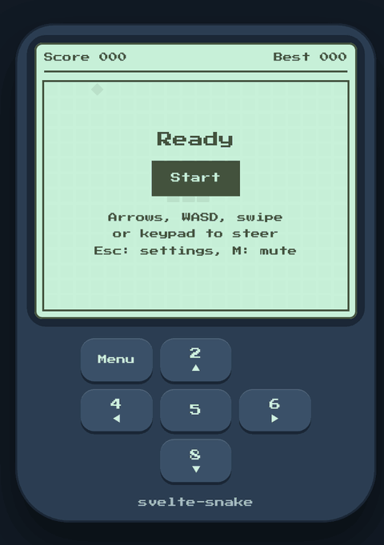

# svelte-snake

<p align="center">
  
</p>

A retro, feature-phone style Snake game built with Svelte 5 and SvelteKit. Dark pixels on a pale LCD, ghost pixels for unlit cells, and a pixel font.

**Status:** the playable MVP, touch controls, a settings panel and sound effects are in place. It installs as an app, plays offline, and passes an automated WCAG 2.2 AA audit. Real screen reader testing and the first deploy are next (see [AGENTS.md](AGENTS.md#roadmap)).

## Controls

| Action                      | Input                                                                     |
| --------------------------- | ------------------------------------------------------------------------- |
| Steer                       | Arrow keys or WASD, swipe on the screen, or the on-screen keys 2, 4, 6, 8 |
| Start / resume / play again | Enter, or the Start / Resume / Play again button                          |
| Pause                       | Space or P, or the on-screen 5 key                                        |
| Settings                    | Esc, or the on-screen Menu key                                            |
| Mute / unmute               | M                                                                         |

The game pauses automatically when the tab is hidden, and when you open the settings.

## Settings

- **Speed:** slow, normal or fast. The snake still speeds up as your score grows. Changes apply immediately.
- **Walls:** by default hitting a wall ends the game. With wrap on, you come out on the opposite side. A change made mid-game applies from the next game.

- **Sound:** retro beeps for eating, game over, winning, starting and pausing. They are synthesized in the browser with the Web Audio API (no audio files) and only start after you press a key or tap. Press **M** to mute; a "Mute" tag shows on the screen while it is off.

Settings and your best score are saved in the browser.

## Development

Requires Node 26 and [pnpm](https://pnpm.io) (the exact version is pinned in `package.json`).

```sh
pnpm install
pnpm dev          # dev server
pnpm test         # unit tests (Vitest)
pnpm test:e2e     # end-to-end tests (Playwright)
pnpm check        # type check (app and service worker)
pnpm lint         # Prettier + ESLint
pnpm build        # static build into ./build
pnpm icons        # regenerate the app icons
pnpm demo         # re-record docs/demo.gif (needs ffmpeg and a running preview)
```

### Re-recording the demo GIF

`docs/demo.gif` is generated, not hand-made: Playwright plays the built game with a fake clock (so every frame is exactly 100 ms apart) and a pinned random seed, a tiny auto-player steers toward the food, and ffmpeg assembles the frames. Re-record it whenever the look of the game changes:

```sh
pnpm build && pnpm preview --port 4173   # terminal 1
pnpm demo                                 # terminal 2 (ffmpeg must be installed)
```

Options such as the seed, the target score and the output width are environment variables, listed at the top of `scripts/record-demo.mjs`.

Before opening a pull request, run `pnpm check && pnpm lint && pnpm test && pnpm build`.

## Accessibility

- Fully playable with a keyboard, with a clear focus ring on both the light screen and the dark phone.
- Screen readers hear when the game starts, pauses, resumes and ends (with the final score), and the score as you eat.
- Works in Windows high-contrast mode, at 320px wide, with large touch targets, and with nothing blinking.
- Every screen is checked with [axe](https://github.com/dequelabs/axe-core) in the end-to-end tests.

Snake is a visual game, so screen reader users cannot follow the snake itself. It has not yet been tested with real assistive technology.

## Install and offline

svelte-snake is a progressive web app. In a supported browser, use "Install" or "Add to Home Screen" to get it as an app with its own icon, and it keeps working with no connection: a service worker caches the whole game on the first visit. When a new version is deployed, it takes over the next time you open the game after closing all its tabs.

## Design decisions

- **Pure engine.** `src/lib/engine` is plain TypeScript with no Svelte, DOM, clock or `Math.random()`. A step is `step(state) -> state`. ESLint enforces the boundary.
- **Deterministic.** A seeded RNG lives inside the game state, so the same seed plus the same inputs always replays the same game. That makes tests reproducible and leaves the door open for server-side score validation.
- **Input queue.** Up to two turns are buffered and validated against the last queued direction, so a quick "up, left" cannot reverse the snake into itself.
- **Fixed timestep.** The loop accumulates frame time into whole ticks, so speed does not depend on the display's refresh rate, and long pauses do not cause a catch-up burst.
- **Thin Svelte layer.** A small runes-based `Game` class wraps the engine; components only render state.
- **Static hosting.** Prerendered with `adapter-static` and deployed to GitHub Pages from GitHub Actions.

## Deployment

Pushes to `main` build and deploy to GitHub Pages. One-time setup: in the repository settings, set **Pages > Source** to **GitHub Actions**. The workflow sets `BASE_PATH` to `/<repo-name>` so assets resolve under the project URL.

## License

To be added.
